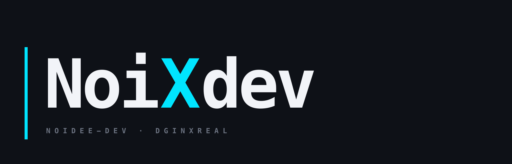

**A small dev label. Two devs. Ship small things.**

🌐 [**noix.dev**](https://www.noix.dev/) · 🐳 [**Docker Hub**](https://hub.docker.com/u/noixdev) · GitHub: you're here 

---

## About

**NoiXdev** is a small dev label run by two people. No roadmap, no meetings, no growth-hacking — just tooling, prototypes and weekend hacks that we wanted to exist. Repos here are shipped when they're ready, not when a sprint says so.

If something here saves you an hour, that's a win. If something is broken, open an issue.

## Members

<table>
<tr>
<td width="50%" valign="top">

### [`@noidee-dev`](https://github.com/noidee-dev)

  
  
  

</td>
<td width="50%" valign="top">

### [`@DGINXREAL`](https://github.com/DGINXREAL)

  
  
  

</td>
</tr>
</table>

## License

Code in this org: MIT, unless a repo says otherwise.
Logos and brand marks: © NoiXdev.

 

noix.dev · <code>noidee-dev</code> & <code>DGINXREAL</code>
